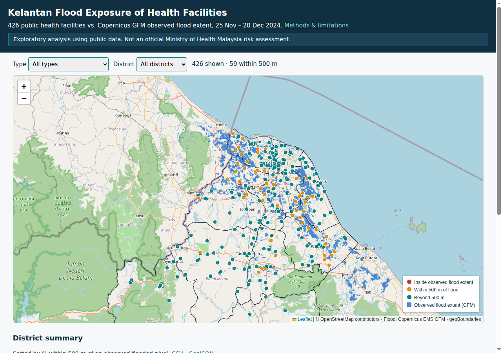

# Kelantan Flood Exposure of Health Facilities

**Live map:** https://ruhaifimd.github.io/kelantan-flood-health-facilities/

> Exploratory analysis using public data. Not an official Ministry of Health Malaysia risk assessment.

Which public health facilities in Kelantan sat inside, or within 500 m of, the flood extent observed by satellite during the Nov–Dec 2024 floods?

| | Count |
|---|---|
| Kelantan facilities in source | 429 |
| Dropped (coordinates outside Kelantan) | 1 |
| Analysed | 428 |
| Inside observed flood extent | 1 |
| Within 500 m of observed flooding | 59 (13.8%) |

Highest share within 500 m: Pasir Puteh (27.8%), Pasir Mas (26.7%), Tumpat (25.0%). The derived data files (district summary, facility GeoJSON, scenario files) live in [`data/`](data/) in this repository.

## Corrections and validation
Corrections are applied from [`scripts/overrides.csv`](scripts/overrides.csv) (source CSV untouched): KK Pintu Geng coordinate corrected (Google Maps, verified by author); KD Dalam Rhu coordinate replaced with its verified location (Google Maps, verified by author); KK Beris Kubor Besar → KK Beris and KK Perol → KK Cabang 3 Perol (official names); Unit Terapi Cara Kerja Ketereh retyped Other / unit. Cross-match with the official MOH KK list: 114 official, 107 exact matches. KK Baroh Pial and KK Bukit Gading are listed as Klinik Desa on moh.gov.my but retained as Klinik Kesihatan per local verification by the author.

**Known data gap:** 4 official KK are missing from the MOH dataset and are not mapped: KK Kubang Kual, KK Lojing, KK Panji, KK Wakaf Che Yeh. See [methods](methods.html#validation).

## Files
- `data/facilities.geojson` – per facility: name, type, district, lat/lon, `in_flood`, `dist_m`, `within_500m`
- `data/district_summary.csv`, `data/dropped.csv`, `data/gfm_scenes.csv`, `data/flood_extent_gfm_2024.tif` (1 flooded, 0 dry, 255 no data)
- `scripts/overrides.csv` – documented corrections; `scripts/pipeline.py` – rebuilds `data/` (`python scripts/pipeline.py`); `scripts/check.py` – assert spot-check of 7 facilities
- `methods.html` – method, overrides, validation, dropped records, limitations

## Limitations
Observed extent is not hazard probability; SAR under-detects urban and vegetated flooding; source coordinate precision varies (2–7 dp). See [methods](methods.html).

## Data sources

### Health facilities
- **Used for:** Facility points (name, type, district, coordinates)
- **Publisher:** Ministry of Health Malaysia (KKM)
- **Dataset:** GitHub repository [MoH-Malaysia/data-resources-public](https://github.com/MoH-Malaysia/data-resources-public), file [`facilities_master.csv`](https://github.com/MoH-Malaysia/data-resources-public/blob/f79256f/facilities_master.csv) (commit `f79256f`)
- **Date:** Snapshot as registered on 31 Dec 2025; 429 Kelantan rows
- **Licence:** No LICENSE file in the source repository; its README requests attribution. Only a derived Kelantan subset (code, name, type, district, coordinates, exposure fields) is republished here. 1 record excluded (coordinates in Penang/Kedah): KD Kepala Batas. 2 coordinates corrected (KK Pintu Geng, KD Dalam Rhu) – see [methods](methods.html#overrides).
- **Validated against:** MOH official Klinik Kesihatan list ([moh.gov.my](https://www.moh.gov.my/fasiliti-kesihatan/klinik-kesihatan/kelantan)), checked 17 Oct 2026

### Flood extent
- **Used for:** Observed flood extent (inside / within 500 m)
- **Publisher:** Copernicus Emergency Management Service (CEMS)
- **Dataset:** GloFAS Global Flood Monitoring (GFM) ensemble observed flood extent from Sentinel-1 SAR, accessed via the EODC STAC API ([stac.eodc.eu](https://stac.eodc.eu/api/v1)); scene list [gfm_scenes.csv](data/gfm_scenes.csv)
- **Date:** 62 scenes, 25 Nov – 20 Dec 2024, merged as “ever flooded”
- **Licence:** Contains modified Copernicus Emergency Management Service information 2024. [CEMS GFM terms of use](https://global-flood.emergency.copernicus.eu/terms-of-use/)

### District boundaries
- **Used for:** State mask and district outlines
- **Publisher:** geoBoundaries (William & Mary geoLab)
- **Dataset:** MYS ADM2, full resolution, [`geoBoundaries-MYS-ADM2.geojson`](https://github.com/wmgeolab/geoBoundaries/raw/9469f09/releaseData/gbOpen/MYS/ADM2/geoBoundaries-MYS-ADM2.geojson) (commit `9469f09`); [geoboundaries.org](https://www.geoboundaries.org/)
- **Date:** geoBoundaries release at commit 9469f09
- **Licence:** [CC BY 4.0](https://creativecommons.org/licenses/by/4.0/)

### Basemap
- **Used for:** Background map tiles
- **Publisher:** OpenStreetMap contributors
- **Dataset:** Standard tiles from `tile.openstreetmap.org`
- **Date:** Live tiles at time of viewing
- **Licence:** © OpenStreetMap contributors, [ODbL](https://www.openstreetmap.org/copyright)

**How to cite:** Muhammad Ruhaifi M.S (2026). *Kelantan Flood Exposure of Health Facilities* [Interactive map]. [https://ruhaifimd.github.io/kelantan-flood-health-facilities/](https://ruhaifimd.github.io/kelantan-flood-health-facilities/)
